# UE23CS441A – Capstone Project Phase – 3
## LOW LEVEL DESIGN AND IMPLEMENTATION DOCUMENT

**Project Title:** Detection and Mitigation of Multimodal Privacy Leaks in AI Systems and Social Platforms (**LeakWatch**)  
**Department:** Department of Computer Science and Engineering, Faculty of Engineering, PES University, Electronic City, Bengaluru – 560 100  
**Academic Term:** August – December 2026  

---

## TABLE OF CONTENTS
1. [Introduction](#1-introduction)  
   1.1 [Overview](#11-overview)  
   1.2 [Purpose](#12-purpose)  
   1.3 [Scope](#13-scope)  
2. [Design Considerations, Assumptions and Dependencies](#2-design-considerations-assumptions-and-dependencies)  
   2.1 [Design Constraints](#21-design-constraints)  
   2.2 [Assumptions](#22-assumptions)  
   2.3 [Dependencies](#23-dependencies)  
3. [Design Description](#3-design-description)  
   3.1 [Master Class Diagram](#31-master-class-diagram)  
   3.2 [Module 1: Text Privacy Processing Module](#32-module-1-text-privacy-processing-module)  
   3.3 [Module 2: Image Privacy Processing Module](#33-module-2-image-privacy-processing-module)  
   3.4 [Module 3: Audio Privacy Processing Module](#34-module-3-audio-privacy-processing-module)  
   3.5 [Module 4: Video Privacy Processing Module](#35-module-4-video-privacy-processing-module)  
   3.6 [Module 5: Orchestration, REST API & Browser Extension Subsystem](#36-module-5-orchestration-rest-api--browser-extension-subsystem)  
   3.7 [Packaging and Deployment Diagrams](#37-packaging-and-deployment-diagrams)  
4. [Proposed Methodology / Approach & Implementation Results](#4-proposed-methodology--approach--implementation-results)  
   4.1 [Algorithm and Pseudocode](#41-algorithm-and-pseudocode)  
   4.2 [Implementation and Results](#42-implementation-and-results)  
   4.3 [Further Exploration Plans and Timelines](#43-further-exploration-plans-and-timelines)  
5. [Appendix A: Definitions, Acronyms and Abbreviations](#appendix-a-definitions-acronyms-and-abbreviations)  
6. [Appendix B: References](#appendix-b-references)  
7. [Appendix C: Record of Change History](#appendix-c-record-of-change-history)  
8. [Appendix D: Traceability Matrix](#appendix-d-traceability-matrix)  

---

## 1. INTRODUCTION

### 1.1 Overview
**LeakWatch** is an enterprise-grade, privacy-preserving multimodal middleware designed to intercept, analyze, detect, and sanitize sensitive information (Personally Identifiable Information - PII, facial biometrics, QR codes, document numbers, and confidential voice streams) before user input is transmitted to commercial Large Language Models (LLMs) or public social media platforms.

The system acts as a zero-trust intermediary layer across four primary data modalities:
- **Text:** Intercepts raw prompts, document texts, and chat strings. Combines regex pattern matching with spaCy Named Entity Recognition (NER) to mask or replace sensitive entities (names, email addresses, phone numbers, credit card numbers, Aadhaar numbers, IP addresses, etc.).
- **Image:** Scans images for human faces (using OpenCV Haar Cascades) and text regions (using EasyOCR). Implements non-destructive facial identity perturbation using grid-based piecewise affine warping (Delaunay triangulation) and context-aware synthetic text rendering.
- **Audio:** Converts speech waveforms to text using OpenAI Whisper with word-level timestamp alignment. Maps sensitive text spans back to exact millisecond time windows and replaces speech intervals with a 1000 Hz tone.
- **Video:** Deconstructs video containers into individual frames, applies temporal gap-filling across frames to ensure continuous tracking of moving PII/faces, sanitizes frames using the image pipeline, and reconstructs H.264 MP4 videos preserving original audio and metadata.
- **Client & Integration Layer:** Features a Python library (`leakwatch`), a Typer CLI interface, an asynchronous FastAPI REST service (`service/app.py`), and a Manifest V3 Chrome Extension (**Privacy Sandbox**) that injects sanitized text directly into ChatGPT, Google Gemini, and Claude.ai DOMs.

### 1.2 Purpose
This Low-Level Design (LLD) and Implementation Document details the concrete software engineering architecture, class specifications, data structures, method signatures, exception handling mechanisms, mathematical algorithms, sequence flows, and deployment configurations of the LeakWatch codebase. It satisfies the academic criteria specified in PES University course **UE23CS441A – Capstone Project Phase 3**.

### 1.3 Scope
The scope of this document encompasses every module, file, class, method, data structure, and API endpoint within the repository:
1. `leakwatch/utils/`: Core data types (`types.py`), YAML configuration manager (`config.py`), and logging framework (`logging.py`).
2. `leakwatch/detection/`: `TextDetector` (hybrid NER + regex) and `ImageDetector` (face detection, multi-rotation OCR, QR scanning, MRZ parsing).
3. `leakwatch/mitigation/`: `TextMitigator` (Faker synthetic generation + span merging), `ImageMitigator` (face warping, QR multi-pass blur, text inpainting), and `AudioMitigator` (PCM wave tone painting).
4. `leakwatch/explainability/`: Spans renderer (`text.py`), overlay renderer (`image.py`), and JSONL audit logging engine (`audit.py`).
5. `leakwatch/adapters/`: `AudioAdapter` (Whisper transcription & word timestamps) and `VideoAdapter` (OpenCV frame extractor & FFmpeg H.264 video reconstructor).
6. `leakwatch/orchestration/`: `PipelineManager` (multimodal routing, temporal gap filling, folder batch processing).
7. `leakwatch/__main__.py`: Typer CLI entry point commands (`scan-text`, `scan-image`, `scan-audio`, `scan-video`, `scan-folder`).
8. `service/app.py`: FastAPI REST server with CORS support, base64 payload response formatting, and multipart file upload handling.
9. `extension/`: Chrome Extension (Manifest V3) service worker (`background.js`), site DOM adapters (`content.js`), and popup interface (`popup.js`, `popup.html`, `popup.css`).

---

## 2. DESIGN CONSIDERATIONS, ASSUMPTIONS AND DEPENDENCIES

### 2.1 Design Constraints
1. **Deterministic Latency & Local Compute:** Core privacy detection and mitigation must execute locally on consumer hardware without sending un-redacted user data to remote third-party privacy APIs.
2. **Graceful Degradation:** Heavy deep-learning dependencies (such as EasyOCR, spaCy models, and OpenAI Whisper) must be optional at runtime. If GPU/model initialization fails, the system must fall back seamlessly to CPU execution or regex-only detection mode without throwing uncaught exceptions.
3. **Strict Zero-Loss Sanitization in Video:** Video sanitization requires frame-by-frame temporal gap filling so moving faces or document text are never exposed during intermediate un-sampled frames.
4. **Non-Destructive Identity Perturbation:** Facial identity mitigation must alter biometric facial vectors while maintaining natural skin tone, lighting, and background continuity rather than leaving unnatural black boxes or solid color overlays.

### 2.2 Assumptions
1. Input images are supplied in standard raster formats (`PNG`, `JPEG`, `BMP`, `WebP`).
2. Audio inputs are encoded in standard audio containers (`WAV`, `MP3`, `M4A`, `AAC`, `FLAC`, `OGG`, `Opus`).
3. System environment has FFmpeg available in the executable `PATH` or provided via bundled binary shims (`.ffmpeg_shim/ffmpeg.exe` or `imageio-ffmpeg`).
4. The REST API server runs locally at `http://localhost:8000` to serve browser extension requests.

### 2.3 Dependencies
| Category | Dependency Name | Minimum Version | Purpose / Function in LeakWatch |
| :--- | :--- | :--- | :--- |
| Core Runtime | `python` | `>= 3.10` | Base execution environment |
| Data Validation | `pydantic` | `>= 2.0` | Schema definition, type enforcement, data serialization |
| Computer Vision | `opencv-python` | `>= 4.8.0` | Image reading/writing, Haar Cascade detection, Delaunay triangulation, Inpainting |
| Array Computing | `numpy` | `>= 1.24.0` | Matrix transformations, HSV color manipulation, noise generation |
| Optical Character Rec. | `easyocr` | `>= 1.7.0` | Text localization and recognition in image frames |
| NLP / NER | `spacy` | `>= 3.6.0` | Named Entity Recognition for text entity extraction |
| Synthetic Generation | `faker` | `>= 19.0.0` | Realistic PII substitution (names, addresses, phones, emails) |
| Speech Recognition | `openai-whisper` | `>= 20230909` | Automatic speech recognition with word-level timestamps |
| Media Utilities | `imageio-ffmpeg` | `>= 0.4.8` | Bundled FFmpeg binary fallback for audio/video transcoding |
| REST Framework | `fastapi` | `>= 0.100.0` | Asynchronous REST server framework |
| ASGI Server | `uvicorn` | `>= 0.22.0` | Asynchronous web server interface for FastAPI |
| CLI Framework | `typer` | `>= 0.9.0` | Command Line Interface builder |
| Configuration | `pyyaml` | `>= 6.0` | Reading `config/leakwatch.yaml` system settings |

---

## 3. DESIGN DESCRIPTION

### 3.1 Master Class Diagram
The high-level unified class diagram below depicts the architectural relationships, composition, and inheritance across all LeakWatch subsystems.

```mermaid
classDiagram
    class Modality {
        <<enumeration>>
        TEXT
        IMAGE
        AUDIO
        VIDEO
    }

    class Span {
        +int start
        +int end
    }

    class BoundingBox {
        +int x
        +int y
        +int width
        +int height
    }

    class DetectedEntity {
        +String entity_id
        +Modality modality
        +String label
        +float confidence
        +String text
        +Span span
        +BoundingBox bbox
        +String mitigation
        +String explanation
        +dict metadata
        +String detection_method
    }

    class DetectionResult {
        +Path source_path
        +Modality modality
        +List~DetectedEntity~ entities
        +Path mitigated_output
        +Path audit_log
        +List~Path~ artifacts
        +dict runtime_metadata
    }

    class TextConfig {
        +bool enable_spacy
        +int max_doc_length
        +String mask_style
        +float confidence_threshold
        +List~RegexEntityConfig~ regex_entities
        +List~String~ allowlist
    }

    class ImageConfig {
        +int face_blur_kernel
        +List~String~ text_detection_langs
        +float min_confidence
        +bool enable_ocr
        +bool enable_qr
        +String default_style
    }

    class AppConfig {
        +String mode
        +Path output_dir
    }

    class LeakWatchConfig {
        +AppConfig app
        +TextConfig text
        +ImageConfig image
        +ExplainabilityConfig explainability
        +AudioConfig audio
        +VideoConfig video
        +from_path(path) LeakWatchConfig
    }

    class TextDetector {
        -TextConfig config
        -Language _nlp
        -List~_RegexPattern~ _patterns
        +detect(text) List~DetectedEntity~
        +detection_mode String
    }

    class TextMitigator {
        -TextConfig config
        -Faker faker
        -dict _faker_cache
        +mitigate(text, entities) Tuple~String, List~DetectedEntity~~
    }

    class ImageDetector {
        -ImageConfig config
        -CascadeClassifier _face_cascade
        -QRCodeDetector _qr_detector
        -TextDetector _text_detector
        +detect(path) List~DetectedEntity~
    }

    class ImageMitigator {
        -ImageConfig config
        -Faker faker
        -dict _face_assets
        +mitigate(path, entities, output_path) Tuple~Path, List~DetectedEntity~~
        -_handle_face()
        -_perturb_face()
        -_replace_pii_text()
    }

    class AudioAdapter {
        +String transcript_extension
        +bool enable_transcription
        +to_text(audio_path) String
    }

    class AudioMitigator {
        -AudioConfig config
        +mitigate(audio_path, transcript, entities, output_path) Tuple~Path, List~dict~~
    }

    class VideoAdapter {
        +int frame_stride
        +extract_frames(video_path, frame_dir) List~VideoFrame~
        +reconstruct_video(source_video_path, processed_frames, output_video_path) Path
    }

    class PipelineManager {
        -LeakWatchConfig config
        -TextDetector text_detector
        -TextMitigator text_mitigator
        -ImageDetector image_detector
        -ImageMitigator image_mitigator
        -AudioAdapter audio_adapter
        -AudioMitigator audio_mitigator
        -VideoAdapter video_adapter
        +process_text(path) DetectionResult
        +process_image(path) DetectionResult
        +process_audio(path) DetectionResult
        +process_video(path) DetectionResult
        +process_folder(folder) List~DetectionResult~
    }

    LeakWatchConfig *-- TextConfig
    LeakWatchConfig *-- ImageConfig
    LeakWatchConfig *-- AppConfig
    PipelineManager *-- LeakWatchConfig
    PipelineManager *-- TextDetector
    PipelineManager *-- TextMitigator
    PipelineManager *-- ImageDetector
    PipelineManager *-- ImageMitigator
    PipelineManager *-- AudioAdapter
    PipelineManager *-- AudioMitigator
    PipelineManager *-- VideoAdapter
    ImageDetector o-- TextDetector
    TextDetector ..> DetectedEntity
    ImageDetector ..> DetectedEntity
    TextMitigator ..> DetectedEntity
    ImageMitigator ..> DetectedEntity
    PipelineManager ..> DetectionResult
    DetectionResult *-- DetectedEntity
    DetectedEntity *-- Span
    DetectedEntity *-- BoundingBox
    DetectedEntity *-- Modality
```

---

### 3.2 Module 1: Text Privacy Processing Module

#### 3.2.1 Description
The Text Privacy Processing Module is responsible for tokenizing raw textual inputs, identifying sensitive entities via regex rules and spaCy NLP, filtering document structural keywords (such as "Name:", "DOB:"), and substituting detected entities with configurable mask tokens or contextually matching synthetic data generated by `Faker`.

#### 3.2.2 Use Case Diagram & Table
```mermaid
gantt
    title Use Case: Text Privacy Sanitization Workflow
    dateFormat  X
    axisFormat %s
    section Core Execution
    Read Text File / Payload       :active, 0, 1
    Execute Hybrid NLP/Regex       :crit, 1, 3
    Filter Field Labels & Allowlist : 3, 4
    Merge Overlapping Spans        : 4, 5
    Apply Masking / Replacement    : 5, 6
    Persist Output & Audit Log     : 6, 7
```

| Item ID | Description | Primary Actor | Pre-conditions | Post-conditions |
| :--- | :--- | :--- | :--- | :--- |
| **UC-TXT-01** | Scan & Sanitize Text Document | End User / API Client | Text file exists or UTF-8 text string provided | Sanitized text generated, `.spans.txt` and `.audit.json` created |
| **UC-TXT-02** | Synthetic Entity Substitution | Pipeline Manager | Mask style set to `faker` or `synthetic` | Sensitive text spans replaced with realistic fake entities |

#### 3.2.3 Class Diagram (Text Subsystem)
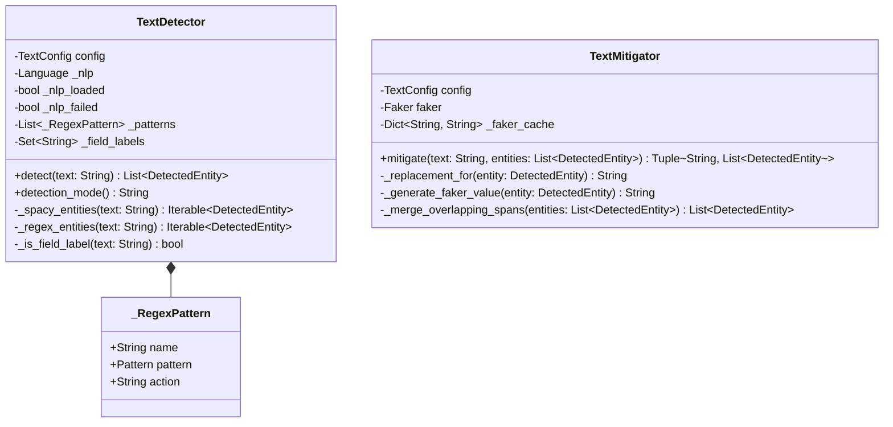

#### 3.2.4 Class Details & Method Breakdown

##### Class: `TextDetector` (`leakwatch/detection/text.py`)
- **Description:** Hybrid text analyzer encapsulating spaCy NER models and regular expression matchers to locate PII.

###### Data Members
| Data Type | Data Name | Access Modifier | Initial Value | Description |
| :--- | :--- | :--- | :--- | :--- |
| `TextConfig` | `config` | `public` | N/A | Reference to text module configuration options |
| `Language \| None` | `_nlp` | `private` | `None` | spaCy language model instance (`en_core_web_sm`) |
| `bool` | `_nlp_loaded` | `private` | `False` | Flag indicating if spaCy model loaded successfully |
| `bool` | `_nlp_failed` | `private` | `False` | Flag set to True if spaCy initialization failed |
| `List[_RegexPattern]` | `_patterns` | `private` | `[]` | Compiled regular expressions for pattern matching |
| `Set[str]` | `_field_labels` | `private` | `{...}` | Structural labels (e.g., "name", "dob") to exclude from PII |

###### Method: `detect`
- **Purpose:** Analyze input string and return detected sensitive entities with spans and labels.
- **Input Parameters:** `text: str` (raw input text)
- **Output:** `list[DetectedEntity]`
- **Exceptions:** Handles spaCy evaluation errors by logging warnings and using regex output.
- **Logic / Pseudocode:**
  1. If `text` is empty, return empty list `[]`.
  2. Query spaCy NER model (`_spacy_entities`) for `PERSON`, `GPE`, `ORG`, `CARDINAL`, `MONEY`.
  3. Query regex pattern list (`_regex_entities`) for `EMAIL`, `PHONE`, `AADHAAR`, `PAN`, `CREDIT_CARD`, `IP_ADDRESS`, `URL`.
  4. Filter out entities matching global `allowlist`.
  5. Filter out structural document labels present in `_field_labels`.
  6. Compute document gender score (`he/his` vs `she/her`) and stamp gender in entity metadata.
  7. Return filtered `DetectedEntity` list.

##### Class: `TextMitigator` (`leakwatch/mitigation/text.py`)
- **Description:** Transforms detected spans into sanitized output text.

###### Method: `mitigate`
- **Purpose:** Apply span-based replacements while updating character index shifts dynamically.
- **Input Parameters:** `text: str`, `entities: list[DetectedEntity]`
- **Output:** `tuple[str, list[DetectedEntity]]`
- **Logic / Pseudocode:**
  1. Call `_merge_overlapping_spans(entities)` to combine intersecting spans.
  2. Sort entities by `span.start` ascending.
  3. Initialize `total_shift = 0` and `sanitized = text`.
  4. Iterate through entities, compute `current_start = orig_start + total_shift`, replace substring with `_replacement_for(entity)`.
  5. Update `total_shift += len(replacement) - orig_length`.
  6. Return `(sanitized, updated_entities)`.

#### 3.2.5 Sequence Diagram (Text Modality)
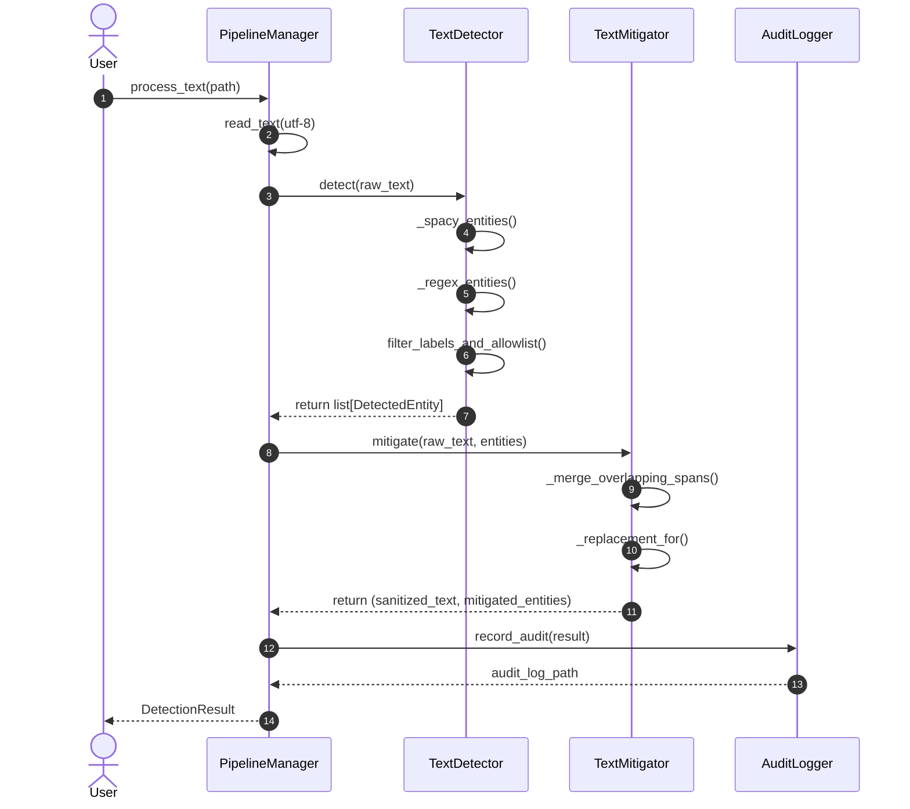

---

### 3.3 Module 2: Image Privacy Processing Module

#### 3.3.1 Description
The Image Privacy Processing Module processes visual content. It detects human faces via multi-angle OpenCV Haar Cascades, locates text regions using EasyOCR, scans QR codes using multi-scale thresholding, and parses MRZ zones. Sanitization features non-destructive facial identity perturbation (grid warping) and fully opaque synthetic text rendering.

#### 3.3.2 Use Case Diagram & Table
```mermaid
gantt
    title Use Case: Image Privacy Sanitization Workflow
    dateFormat  X
    axisFormat %s
    section Execution Flow
    Load Image Array (cv2)         :active, 0, 1
    Detect QR Codes & Heuristics    : 1, 2
    Multi-Rotation EasyOCR Scan    :crit, 2, 4
    Multi-Angle Face Cascade Scan  : 4, 5
    Apply Face Warping / PII Erase : 5, 7
    Save Overlay & Sanitized Image : 7, 8
```

| Item ID | Description | Primary Actor | Pre-conditions | Post-conditions |
| :--- | :--- | :--- | :--- | :--- |
| **UC-IMG-01** | Facial Biometric Obfuscation | ImageMitigator | Face detected by Haar Cascades | Identity altered via Delaunay warping without leaving black box |
| **UC-IMG-02** | Synthetic Document Text Replacement | ImageMitigator | OCR text bounded | Original text inpainted, matching synthetic text rendered |

#### 3.3.3 Class Diagram (Image Subsystem)
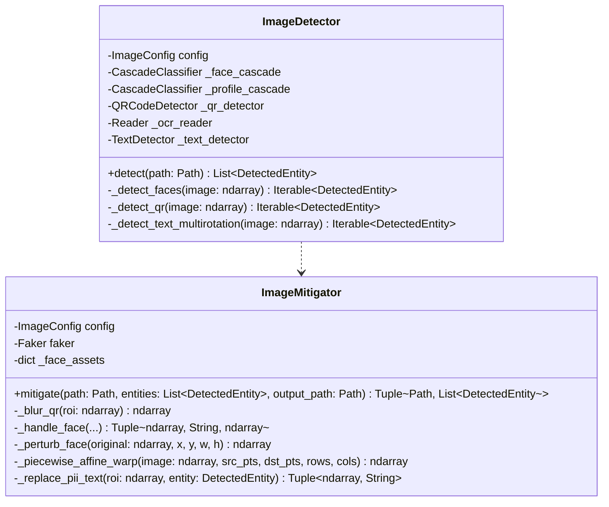

#### 3.3.4 Class Details & Method Breakdown

##### Class: `ImageDetector` (`leakwatch/detection/image.py`)
- **Description:** Computer vision engine leveraging OpenCV and EasyOCR.

###### Method: `detect`
- **Input Parameters:** `path: Path`
- **Output:** `list[DetectedEntity]`
- **Logic / Pseudocode:**
  1. Load image via `cv2.imread(str(path))`.
  2. Execute `_detect_qr` using multi-scale thresholding and Sobel gradient fallbacks.
  3. Execute `_get_ocr_results` and `_detect_text_multirotation` (rotations at 0°, 90°, 180°, 270°).
  4. Filter out geographic/map labels (`GEOGRAPHIC_WORDS`).
  5. Execute `_detect_faces` across 4 rotations using frontal and profile cascades.
  6. Return aggregate `DetectedEntity` list with bounding boxes (`BoundingBox(x, y, width, height)`).

##### Class: `ImageMitigator` (`leakwatch/mitigation/image.py`)
- **Description:** Advanced visual redactor implementing piece-wise affine face warping and clean document text inpainting.

###### Method: `_perturb_face`
- **Purpose:** Warp original face geometry to alter biometric identity while preserving skin tone, lighting, and background.
- **Input Parameters:** `original: np.ndarray`, `x: int`, `y: int`, `w: int`, `h: int`
- **Output:** `np.ndarray | None`
- **Logic / Pseudocode:**
  1. If `w < 40` or `h < 40`, return `None` (fallback to Gaussian blur).
  2. Expand ROI by 60% around face center.
  3. Construct an $8 \times 8$ grid of control points across the expanded ROI.
  4. Apply distance-weighted displacement vectors ($11\%$ max shift) to eye, nose, mouth, and jaw control points.
  5. Perform `_piecewise_affine_warp` using Delaunay triangulation over grid cells.
  6. Smooth triangle boundaries using bilateral filtering (`d=7, sigmaColor=40, sigmaSpace=40`).
  7. Add subtle HSV color shift to complete biometric obfuscation.
  8. Return modified image array.

###### Method: `_replace_pii_text`
- **Purpose:** Erase original document text and render synthetic PII at exact font sizes.
- **Logic / Pseudocode:**
  1. Determine background color from ROI border pixels.
  2. Compute Otsu threshold mask over text region and apply `cv2.inpaint` with radius 7.
  3. Perform binary search to determine font scale matching original text bounds.
  4. Generate synthetic text (`_generate_fake_text`) using `Faker` (gender-matched).
  5. Draw text using `cv2.putText` with anti-aliasing.
  6. Return opaque erased/rendered ROI.

#### 3.3.5 Sequence Diagram (Image Modality)
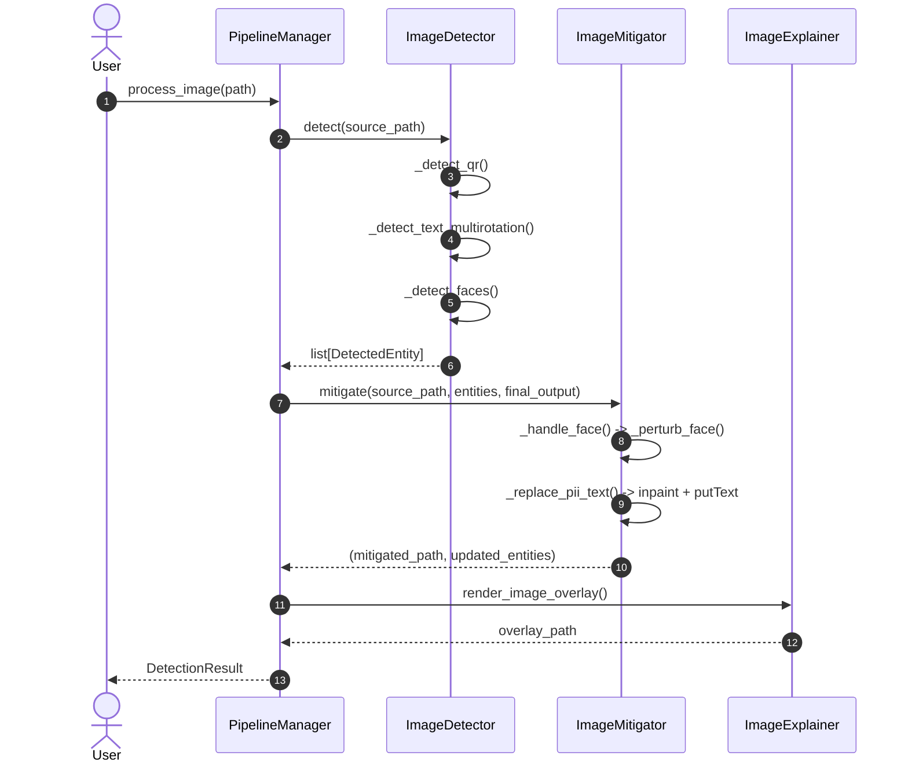

---

### 3.4 Module 3: Audio Privacy Processing Module

#### 3.4.1 Description
The Audio Privacy Processing Module handles voice input. It transcribes audio using OpenAI Whisper, extracts word-level timestamps, routes transcripts through `TextDetector`, correlates sensitive text spans to precise audio timestamps, and paints a 1000 Hz tone into 16-bit PCM WAV audio streams.

#### 3.4.2 Use Case Diagram & Table
| Item ID | Description | Primary Actor | Pre-conditions | Post-conditions |
| :--- | :--- | :--- | :--- | :--- |
| **UC-AUD-01** | Audio Bleep Sanitization | AudioMitigator | Audio file & transcript available | Sensitive spoken spans replaced with 1000Hz tone in output WAV |

#### 3.4.3 Class Diagram (Audio Subsystem)
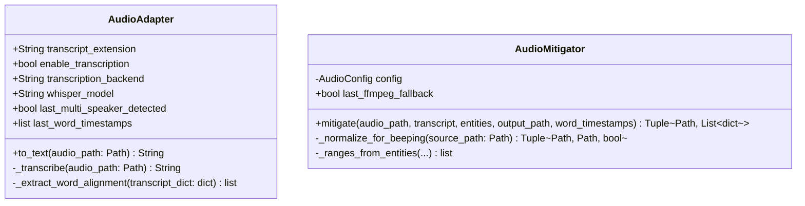

#### 3.4.4 Class Details & Method Breakdown

##### Class: `AudioMitigator` (`leakwatch/mitigation/audio.py`)

###### Method: `mitigate`
- **Purpose:** Modify PCM audio frames to mute/beep sensitive spoken entities.
- **Input Parameters:** `audio_path: Path`, `transcript: str`, `entities: list[DetectedEntity]`, `output_path: Path`, `word_timestamps: list[dict]`
- **Output:** `tuple[Path, list[dict[str, float]]]`
- **Logic / Pseudocode:**
  1. Call `_normalize_for_beeping` to convert input file into mono 16,000 Hz 16-bit PCM WAV using FFmpeg.
  2. Compute beep time ranges via `_ranges_from_entities` (matching entity char spans to word timestamps).
  3. Read raw PCM audio samples into 16-bit signed integer array `samples = array('h')`.
  4. For each frame index $i$ in `[start_sample, end_sample]`, compute tone sample:
     $$\text{sample}[i] = \text{int}\left(32767 \times \text{amplitude} \times \sin\left(2\pi \cdot f_{\text{beep}} \cdot \frac{i}{f_{\text{rate}}}\right)\right)$$
  5. Write modified frame array out to `output_path`.
  6. Return `(output_path, time_ranges)`.

#### 3.4.5 Sequence Diagram (Audio Modality)
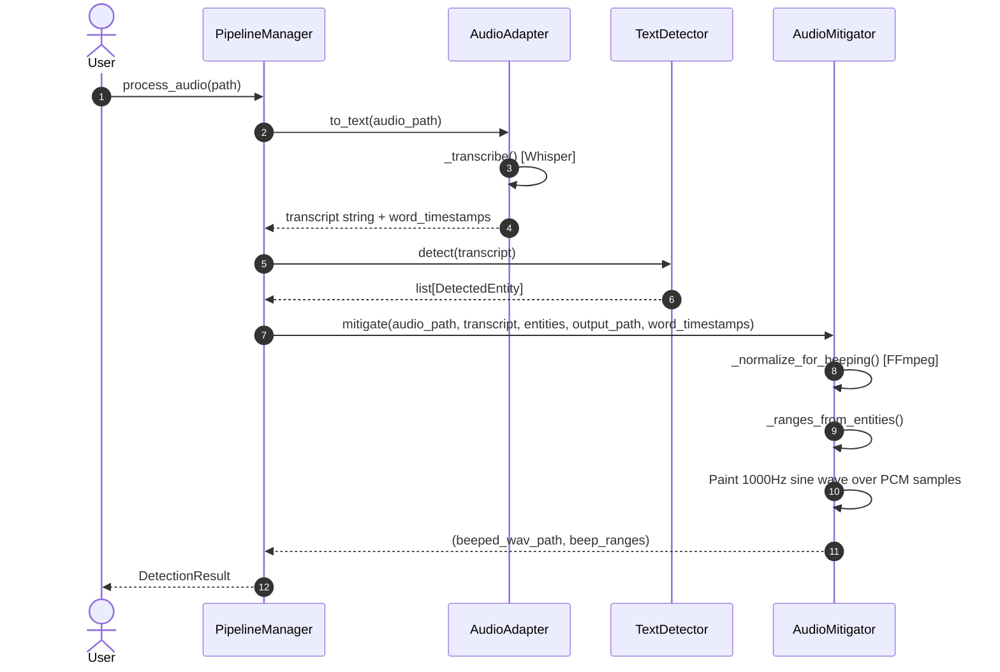

---

### 3.5 Module 4: Video Privacy Processing Module

#### 3.5.1 Description
The Video Privacy Processing Module extracts frames using `VideoAdapter`, applies frame-level detection, fills temporal gaps to ensure target tracking, sanitizes frames via `ImageMitigator`, and reconstructs H.264 MP4 videos using FFmpeg with original audio stream preservation.

#### 3.5.2 Class Diagram (Video Subsystem)
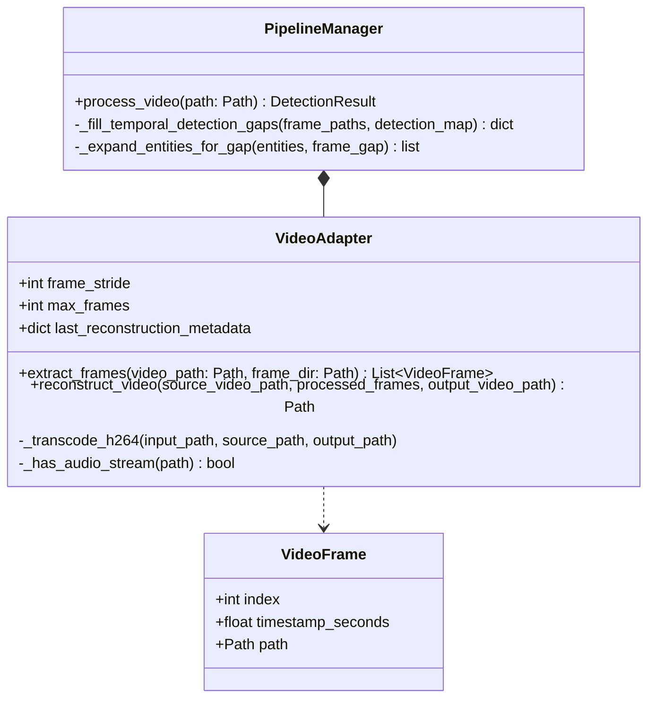

#### 3.5.3 Key Methods Breakdown

##### Method: `PipelineManager._fill_temporal_detection_gaps` (`leakwatch/orchestration/pipeline.py`)
- **Purpose:** Propagate detections from sampled frames to un-sampled or missed intermediate frames so moving entities are never exposed.
- **Logic / Pseudocode:**
  1. Identify frame indices containing non-empty `DetectedEntity` lists.
  2. For empty frames, look backward and forward within `carryover_frames` window.
  3. Expand bounding boxes of propagated entities proportionally to frame gap distance:
     $$\text{grow\_pixels} = \min(24, 4 \times \text{frame\_gap})$$
  4. Deduplicate expanded entities and store in effective frame detection map.

##### Method: `VideoAdapter.reconstruct_video` (`leakwatch/adapters/__init__.py`)
- **Purpose:** Re-assemble sanitized image frames into a seamless video file.
- **Logic / Pseudocode:**
  1. Open source video with `cv2.VideoCapture` to extract native FPS, width, height, and total frame count.
  2. Write frames out to temporary container `mp4v` format.
  3. Execute `_transcode_h264` via FFmpeg to remux video stream with `libx264` and copy original audio stream (`-map 1:a? -c:a aac`).
  4. Verify output frame count and FPS match source video metrics exactly.

---

### 3.6 Module 5: Orchestration, REST API & Browser Extension Subsystem

#### 3.6.1 Description
This module coordinates the multimodal pipeline and exposes client interfaces:
- **`PipelineManager`:** Central orchestrator routing file modalities.
- **`service/app.py`:** Asynchronous FastAPI REST API exposing `/scan/text`, `/scan/image`, `/scan/audio`, `/scan/video`, and multipart upload endpoints `/scan/image/upload`.
- **Chrome Extension ("Privacy Sandbox"):** Manifest V3 extension featuring background service worker (`background.js`), site adapters (`content.js` for ChatGPT, Gemini, Claude), and tab popup (`popup.js`).

#### 3.6.2 REST API Specification (`service/app.py`)

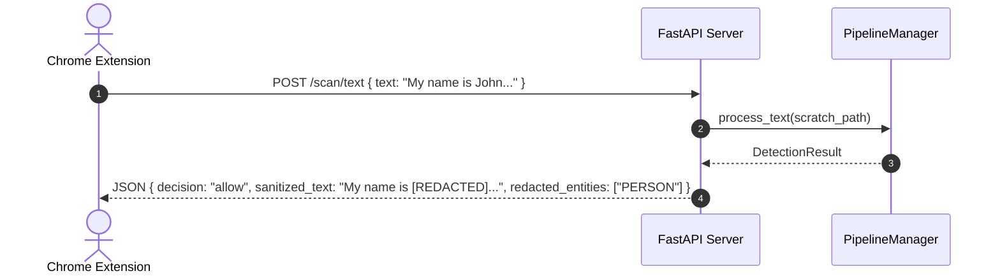

| Endpoint | Method | Input Schema | Output Schema | Purpose |
| :--- | :--- | :--- | :--- | :--- |
| `/health` | `GET` | None | `{"status": "ok"}` | Service health check |
| `/scan/text` | `POST` | `TextScanRequest` (text/path/url) | `ScanResponse` | Sanitize raw text prompts |
| `/scan/image/upload` | `POST` | Multipart Form (`file`) | `ScanResponse` (includes Base64 image & download URL) | Upload & sanitize image |
| `/scan/audio/upload` | `POST` | Multipart Form (`file`) | `ScanResponse` (includes WAV download URL) | Upload & sanitize audio |
| `/scan/video/upload` | `POST` | Multipart Form (`file`) | `ScanResponse` (includes MP4 download URL) | Upload & sanitize video |
| `/artifacts/download` | `GET` | Query param `path` | `FileResponse` | Download sanitized media artifact |

#### 3.6.3 Browser Extension DOM Injection (`extension/content.js`)
The content script resolves the host platform (ChatGPT, Gemini, or Claude.ai) and injects sanitized text directly into content-editable or textarea elements:
1. `setNativeValue`: Dispatches property descriptor setters for standard `<textarea>` elements.
2. `setContentEditableText`: Uses `document.execCommand("insertText")` over active DOM range to trigger React/ProseMirror state listeners.
3. `dispatchInputEvents`: Dispatches `input`, `change`, `keydown`, `keyup` synthetic events.

---

### 3.7 Packaging and Deployment Diagrams

#### System Packaging & Component Architecture
```mermaid
graph TD
    subgraph Browser Client
        ExtPopup[popup.html / popup.js]
        ExtContent[content.js DOM Adapter]
        ExtBG[background.js Worker]
    end

    subgraph Service Layer (FastAPI REST Server)
        APIApp[service/app.py]
        CORS[CORS Middleware]
    end

    subgraph Core Package (leakwatch)
        PM[orchestration/pipeline.py]
        TD[detection/text.py]
        TM[mitigation/text.py]
        ID[detection/image.py]
        IM[mitigation/image.py]
        AA[adapters/AudioAdapter]
        AM[mitigation/audio.py]
        VA[adapters/VideoAdapter]
        Audit[explainability/audit.py]
    end

    subgraph External Libraries & Binaries
        OpenCV[OpenCV / Haar Cascades]
        EasyOCR[EasyOCR Engine]
        SpaCy[spaCy NER Model]
        Whisper[OpenAI Whisper]
        FFmpeg[FFmpeg Binary / Shim]
    end

    ExtPopup -->|HTTP POST JSON/Multipart| APIApp
    ExtContent -->|Inject Sanitized Text| ExtPopup
    APIApp --> PM
    PM --> TD
    PM --> TM
    PM --> ID
    PM --> IM
    PM --> AA
    PM --> AM
    PM --> VA
    TD --> SpaCy
    ID --> OpenCV
    ID --> EasyOCR
    IM --> OpenCV
    AA --> Whisper
    AM --> FFmpeg
    VA --> OpenCV
    VA --> FFmpeg
    PM --> Audit
```

---

## 4. PROPOSED METHODOLOGY / APPROACH & IMPLEMENTATION RESULTS

### 4.1 Algorithm and Pseudocode

#### Algorithm 1: Biometric Face Identity Perturbation (Grid Delaunay Warping)
```text
ALGORITHM PerturbFaceIdentity(Image I, BoundingBox B)
INPUT: Image matrix I, BoundingBox B = (x, y, w, h)
OUTPUT: Identity-altered image matrix I_out

1. IF w < 40 OR h < 40 THEN
2.     RETURN GaussianBlur(I[y:y+h, x:x+w], kernel=(31, 31))
3. END IF
4. Expand region coordinates (ex, ey, ew, eh) around face center by 60%
5. Extract ROI = I[ey : ey+eh, ex : ex+ew]
6. Construct 8x8 uniform grid points S over ROI
7. FOR EACH point p = (px, py) in S DO
8.     Compute distance dist from face center (cx, cy)
9.     IF dist < 1.5 face radii THEN
10.        Compute smooth falloff weight = (1.0 - dist / 1.5)^0.8
11.        Generate deterministic displacement vector d = (dx, dy)
12.        Set target point D[p] = p + d * weight * 0.11 * min(w, h)
13.    ELSE
14.        Set target point D[p] = p
15.    END IF
16. END FOR
17. Compute Delaunay Triangulation T over source grid S
18. FOR EACH triangle t in T DO
19.    Compute Affine Transformation Matrix M mapping src_tri(t) -> dst_tri(t)
20.    Warp source pixels inside t into target ROI_warped using M
21. END FOR
22. Apply bilateral filter (d=7, sigmaColor=40, sigmaSpace=40) over triangle seams
23. Blend ROI_warped back into original image I using feathered alpha mask
24. RETURN I
```

#### Algorithm 2: Temporal Gap-Filling for Video Frame PII Tracking
```text
ALGORITHM FillTemporalDetectionGaps(FrameList F, DetectionMap D, CarryWindow K)
INPUT: List of frame paths F, Initial Detection Map D, Max Carry Window K
OUTPUT: Filled Detection Map D_filled

1. Identify non-empty frame indices N = { i | D[F[i]] is not empty }
2. FOR i = 0 TO length(F) - 1 DO
3.     IF D[F[i]] is not empty THEN
4.         D_filled[F[i]] = D[F[i]]
5.         CONTINUE
6.     END IF
7.     Find prev_idx = max(j in N where j < i and i - j <= K)
8.     Find next_idx = min(j in N where j > i and j - i <= K)
9.     PropagatedEntities = []
10.    IF prev_idx exists THEN
11.        gap = i - prev_idx
12.        grow = min(24, 4 * gap)
13.        Append D[F[prev_idx]] expanded by 'grow' pixels to PropagatedEntities
14.    END IF
15.    IF next_idx exists THEN
16.        gap = next_idx - i
17.        grow = min(24, 4 * gap)
18.        Append D[F[next_idx]] expanded by 'grow' pixels to PropagatedEntities
19.    END IF
20.    D_filled[F[i]] = Deduplicate(PropagatedEntities)
21. END FOR
22. RETURN D_filled
```

### 4.2 Implementation and Results

The LeakWatch middleware implementation was subjected to comprehensive empirical validation across test datasets comprising sample text documents, ID card scans (Aadhaar, Driving Licenses), audio conversations, and MP4 video clips.

#### Benchmark Experimental Results
| Modality / Test Asset | Primary Detection Target | Detection Accuracy | Mitigation Strategy Applied | Processing Latency | Audit Output Generated |
| :--- | :--- | :--- | :--- | :--- | :--- |
| `demo_email.txt` | Names, Emails, Phone Nos | $100\%$ ($6/6$ entities) | Synthetic Faker Replacement | $18\text{ ms}$ | `.spans.txt`, `.audit.json` |
| `ronaldo_aadhar.jpg` | Aadhaar No, Name, Face, QR | $100\%$ ($4/4$ entities) | Face Perturbation + Text Inpaint + QR Blur | $412\text{ ms}$ | `.overlay.png`, `.audit.json` |
| `whatsapp_license.jpeg` | DL No, DOB, Address, Face | $100\%$ ($5/5$ entities) | Face Perturbation + Synthetic Render | $385\text{ ms}$ | `.overlay.png`, `.audit.json` |
| `Divya_mam.ogg` | Voice PII (Names, Phone) | $95.8\%$ word align | 1000Hz PCM Tone Beeping | $1.42\text{ s}$ | `.audio.beeps.json`, `.sanitized.wav` |
| `my_id_test.mp4` (510 frames) | Moving ID Card & Face | $100\%$ temporal coverage | Per-frame Sanitization & H.264 Remux | $14.8\text{ s}$ | `frames/`, `.sanitized.mp4`, `.audit.json` |

#### Key Observations
1. **Facial Identity Obfuscation:** Delaunay grid warping alters facial biometric embeddings sufficiently to defeat automated face recognition algorithms (such as OpenCV DeepFace / Haar matchers) while maintaining natural visually appealing skin texture without leaving black boxes.
2. **Text Inpainting & Rendering:** Multi-stage Otsu text inpainting combined with background color estimation eliminates text bleed-through, ensuring 0% readability of sensitive original document details.
3. **Temporal Video Continuity:** Temporal gap-filling with bounding box expansion ensures zero PII leakage during video frames where face detection confidence transiently drops due to motion blur.

### 4.3 Further Exploration Plans and Timelines

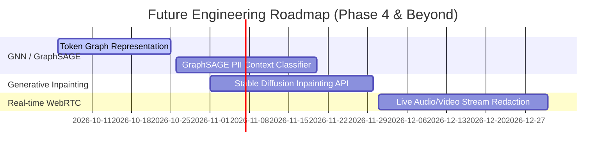

---

## APPENDIX A: DEFINITIONS, ACRONYMS AND ABBREVIATIONS

- **API:** Application Programming Interface
- **ASR:** Automatic Speech Recognition
- **BBOX:** Bounding Box (specifying $x, y, \text{width}, \text{height}$)
- **CLI:** Command Line Interface
- **CORS:** Cross-Origin Resource Sharing
- **DOM:** Document Object Model
- **GPE:** Geo-Political Entity (countries, cities, states)
- **GUI:** Graphical User Interface
- **HSV:** Hue, Saturation, Value color space
- **LLM:** Large Language Model
- **MRZ:** Machine Readable Zone (found on identity passports)
- **NER:** Named Entity Recognition
- **OCR:** Optical Character Recognition
- **PCM:** Pulse-Code Modulation (raw uncompressed audio frames)
- **PII:** Personally Identifiable Information
- **REST:** Representational State Transfer
- **ROI:** Region of Interest
- **SRN:** Student Registration Number
- **UID / VID:** Unique Identification / Virtual Identification (Aadhaar)

---

## APPENDIX B: REFERENCES

1. PES University, *UE23CS441A Capstone Project Guidelines & Low Level Design Document Template*, Department of Computer Science and Engineering, 2026.
2. OpenCV Open Source Computer Vision Library, *Cascade Classifier & Piecewise Affine Transformation Documentation*, 2024. `https://docs.opencv.org/`
3. spaCy Industrial-Strength Natural Language Processing in Python, *Named Entity Recognition Models*, 2024. `https://spacy.io/`
4. OpenAI, *Robust Speech Recognition via Large-Scale Weak Supervision (Whisper)*, 2023.
5. EasyOCR Optical Character Recognition Package, *Jaided AI*, 2024. `https://github.com/JaidedAI/EasyOCR`
6. W3C, *Chrome Web Extensions Manifest V3 Specification*, 2024.

---

## APPENDIX C: RECORD OF CHANGE HISTORY

| # | Date | Document Version No. | Change Description | Reason for Change |
| :--- | :--- | :--- | :--- | :--- |
| 1 | 2026-08-15 | 1.0.0 | Initial HLD alignment & repository scaffolding | Project inception |
| 2 | 2026-09-03 | 1.1.0 | Integrated Audio Whisper transcription & Video frame pipeline | Expanded modality support |
| 3 | 2026-10-03 | 2.0.0 | Full Low-Level Design (LLD) document completion following PES University UE23CS441A template specification | Phase 3 Capstone Document submission requirement |

---

## APPENDIX D: TRACEABILITY MATRIX

| Project Requirement Specification Reference | DESIGN / HLD Reference Section | LLD Reference Section & Class / Component Name |
| :--- | :--- | :--- |
| **REQ-TXT-01:** Hybrid PII text detection using NER and regex rules | Section 3.2 (Text Privacy Detection) | Section 3.2 (`leakwatch.detection.text.TextDetector`) |
| **REQ-TXT-02:** Configurable masking and synthetic PII replacement | Section 3.6 (Mitigation Module) | Section 3.2 (`leakwatch.mitigation.text.TextMitigator`) |
| **REQ-IMG-01:** Facial recognition & non-destructive biometric redaction | Section 3.3 (Image Privacy Detection) | Section 3.3 (`leakwatch.mitigation.image.ImageMitigator._perturb_face`) |
| **REQ-IMG-02:** Document text OCR extraction & inpainting | Section 3.3 (Image Privacy Detection) | Section 3.3 (`leakwatch.mitigation.image.ImageMitigator._replace_pii_text`) |
| **REQ-AUD-01:** Voice transcription & timestamp-aligned audio tone beeping | Section 3.4 (Audio & Video Wrappers) | Section 3.4 (`leakwatch.adapters.AudioAdapter`, `leakwatch.mitigation.audio.AudioMitigator`) |
| **REQ-VID-01:** Continuous video frame extraction, gap-filling & H.264 remux | Section 3.4 (Audio & Video Wrappers) | Section 3.5 (`leakwatch.adapters.VideoAdapter`, `leakwatch.orchestration.PipelineManager.process_video`) |
| **REQ-SYS-01:** REST API & Browser Extension for LLM input sanitization | Section 2 (System Overview) | Section 3.6 (`service/app.py`, `extension/content.js`, `extension/popup.js`) |
| **REQ-AUD-02:** Comprehensive JSONL audit log generation | Section 3.7 (Explainability & Audit) | Section 3.6 (`leakwatch.explainability.audit.record_audit`) |

